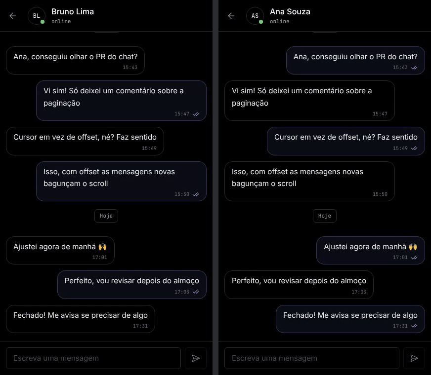
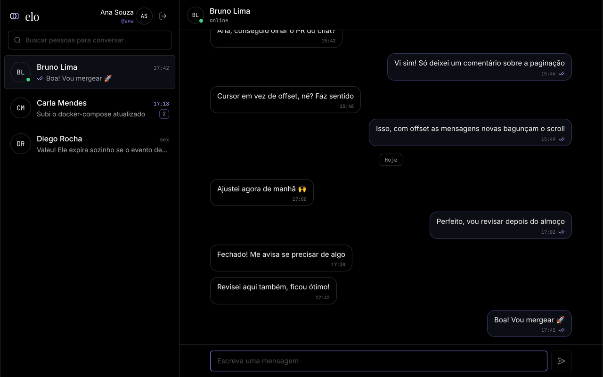
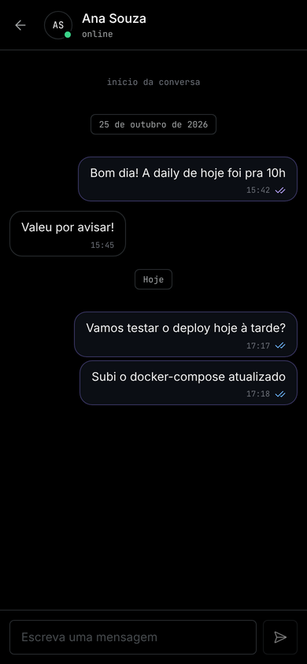
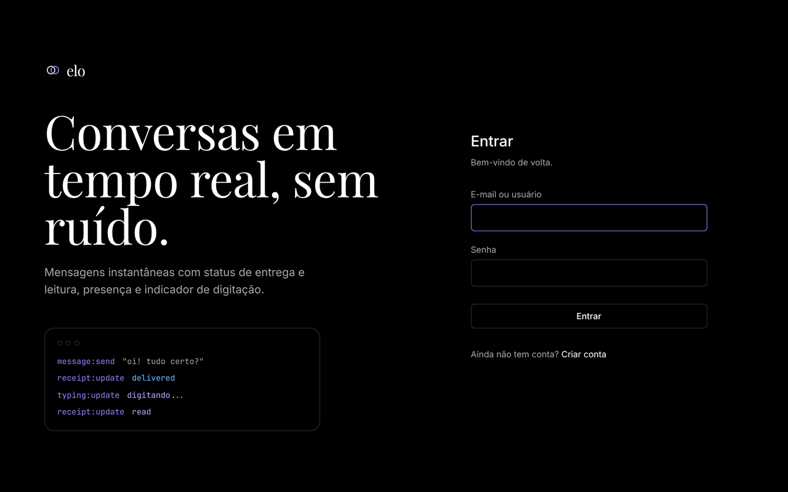
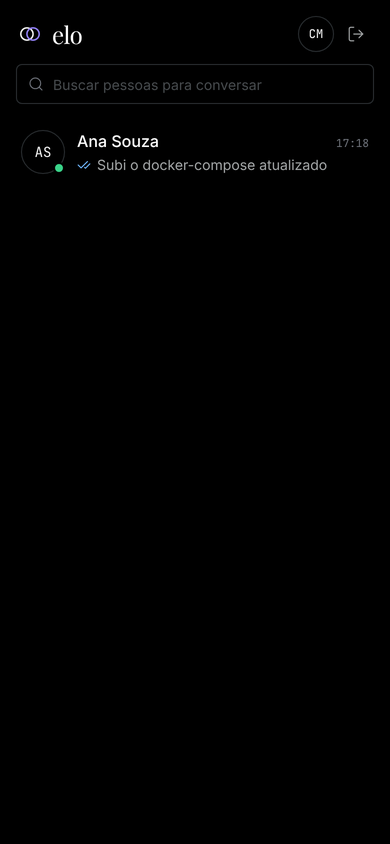
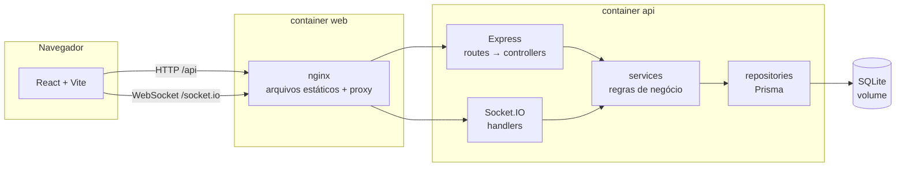
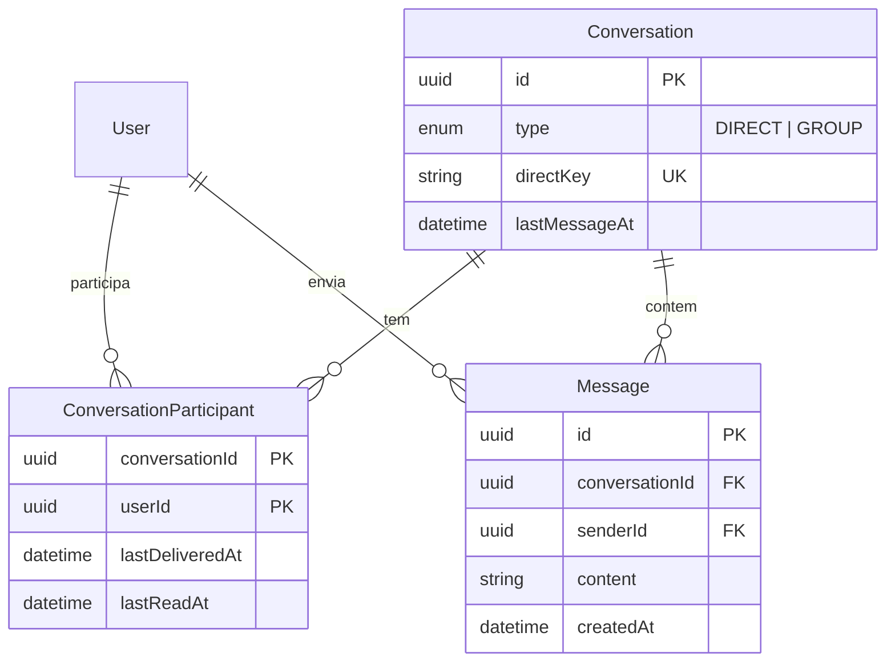

# Elo

**Mensageiro em tempo real** com status de entrega e leitura, presença online, indicador de digitação e histórico com scroll infinito.



</div>

---

## Sumário

- [Sobre](#sobre)
- [Funcionalidades](#funcionalidades)
- [Screenshots](#screenshots)
- [Stack](#stack)
- [Arquitetura](#arquitetura)
- [Como rodar](#como-rodar)
- [Testes](#testes)
- [Decisões técnicas](#decisões-técnicas)
- [Próximos passos](#próximos-passos)

## Sobre

O Elo é um app de mensagens 1 a 1 inspirado nos mensageiros que usamos todo dia, com nome e identidade visual próprios. Foi construído como projeto de portfólio para mostrar, de ponta a ponta:

- **comunicação em tempo real** com Socket.IO autenticado;
- **autenticação** com JWT e bcrypt;
- **modelagem de dados** pensada para as consultas que o app faz (status derivado, paginação por cursor, unicidade garantida pelo banco);
- **qualidade**: back-end em camadas, validação com Zod, 55 testes automatizados, lint e CI;
- **deploy** com Docker Compose (API + front servido por nginx).

## Funcionalidades

- [x] Cadastro e login com validação por campo
- [x] Lista de conversas com última mensagem, horário e contador de não lidas
- [x] Chat 1 a 1 em tempo real com envio otimista (aparece na hora, confirma pelo servidor, permite reenviar se falhar)
- [x] Status da mensagem: enviada ✓, entregue ✓✓ (azul) e lida ✓✓ (violeta)
- [x] Indicador "digitando..."
- [x] Online/offline e "visto por último", corretos com várias abas abertas
- [x] Histórico paginado com scroll infinito
- [x] Busca de usuários para iniciar conversa
- [x] Layout responsivo (desktop lado a lado; celular uma tela por vez)
- [x] Ressincronização automática ao reconectar

## Screenshots

| Desktop                                                               | Celular                                                                                        |
| --------------------------------------------------------------------- | ---------------------------------------------------------------------------------------------- |
|  |                |
|           |  |

## Stack

| Camada           | Tecnologias                                                       |
| ---------------- | ----------------------------------------------------------------- |
| Back-end         | Node.js 22, Express 5, **JavaScript puro (ES Modules) com JSDoc** |
| Tempo real       | Socket.IO 4                                                       |
| Banco            | SQLite + Prisma ORM                                               |
| Auth e segurança | JWT, bcrypt, Zod, helmet, CORS, express-rate-limit                |
| Front-end        | React 19, Vite, Tailwind CSS 4, React Router                      |
| Qualidade        | ESLint, Prettier, Jest + Supertest + socket.io-client             |
| Infra            | Docker, Docker Compose, nginx, GitHub Actions                     |

## Arquitetura



O navegador fala com **uma única origem**: o nginx serve o front e repassa `/api` e `/socket.io` para a API. Em desenvolvimento, o proxy do Vite faz o mesmo papel.

### Back-end em camadas

```
server/src/
├── routes/         URL → middlewares → controller
├── controllers/    traduz HTTP ⇄ service (sem regra de negócio)
├── services/       regras de negócio, usadas tanto pelo REST quanto pelo socket
├── repositories/   único lugar que acessa o Prisma
├── sockets/        handshake JWT, handlers de eventos, emissão por sala de usuário
├── validators/     schemas Zod (body, params, query e payloads do socket)
├── middlewares/    authenticate, validate, rateLimit, errorHandler
├── utils/          AppError, cursor de paginação, derivação de status
└── config/         variáveis de ambiente validadas no boot
```

Cada camada só conhece a de baixo. A rota REST `POST /messages` e o evento `message:send` chamam **o mesmo** `messageService.send`, então a regra de negócio existe em um lugar só.

### API REST

Todas as rotas, exceto cadastro e login, exigem `Authorization: Bearer <token>`. Erros seguem sempre o formato `{ "error": { "code", "message", "details?" } }`.

| Método | Rota                                      | Descrição                                       |
| ------ | ----------------------------------------- | ----------------------------------------------- |
| `POST` | `/api/auth/register`                      | Cadastro (já devolve token)                     |
| `POST` | `/api/auth/login`                         | Login por e-mail **ou** username                |
| `GET`  | `/api/auth/me`                            | Usuário autenticado                             |
| `GET`  | `/api/users/search?q=`                    | Busca por nome ou @username                     |
| `GET`  | `/api/conversations`                      | Conversas com última mensagem e não lidas       |
| `POST` | `/api/conversations/direct`               | Abre/cria conversa (201 cria, 200 já existia)   |
| `GET`  | `/api/conversations/:id/messages?cursor=` | Histórico paginado por cursor                   |
| `POST` | `/api/conversations/:id/messages`         | Envia mensagem (também propagada em tempo real) |

### Eventos do Socket.IO

O token vai no handshake (`io({ auth: { token } })`) e é validado antes de aceitar a conexão.

| Cliente → servidor                             | Servidor → cliente                     |
| ---------------------------------------------- | -------------------------------------- |
| `message:send` (ack `{ tempId, message }`)     | `message:new`                          |
| `conversation:delivered` · `conversation:read` | `receipt:update` · `conversation:read` |
| `typing:start` · `typing:stop`                 | `typing:update`                        |
| `presence:get` (ack `{ statuses }`)            | `presence:update`                      |

### Modelo de dados



Diagrama completo e justificativas em [`docs/data-model.md`](docs/data-model.md).

## Como rodar

### Com Docker (recomendado)

Pré-requisito: Docker com Compose.

```bash
git clone https://github.com/DutraBrun0/elo.git && cd elo
cp .env.example .env          # defina um JWT_SECRET (o comando para gerar está no arquivo)
docker compose up --build
```

Acesse **http://localhost:8080**. As migrations rodam sozinhas quando a API sobe.

Para popular com usuários de demonstração (senha `elo12345`: `ana`, `bruno`, `carla`, `diego`, `elisa`):

```bash
docker compose exec -e NODE_ENV=development api npm run db:seed
```

> Dica: abra duas janelas (uma anônima), entre como `ana` e `bruno` e converse para ver o tempo real.

### Em modo de desenvolvimento

Pré-requisito: Node.js 22 (`.nvmrc`).

```bash
npm install                                 # instala server e web (npm workspaces)
cp server/.env.example server/.env
npm run db:migrate --workspace server       # cria o banco SQLite
npm run db:seed --workspace server          # opcional: dados de demonstração
npm run dev                                 # API em :3333 e front em :5173
```

Acesse **http://localhost:5173**.

### Scripts úteis

| Comando                                | O que faz                              |
| -------------------------------------- | -------------------------------------- |
| `npm test`                             | Testes do back-end                     |
| `npm run lint`                         | ESLint em todo o monorepo              |
| `npm run format`                       | Prettier                               |
| `npm run db:studio --workspace server` | Prisma Studio para inspecionar o banco |

## Testes

```bash
npm test
```

São **55 testes** no back-end, rodando contra um banco SQLite real recriado a cada execução:

- **Unitários**: derivação de status (inclusive em grupos) e cursor de paginação.
- **Integração HTTP (Supertest)**: cadastro e login, normalização de dados, hash da senha, erros 401/404/409/422, busca, criação idempotente de conversa (inclusive dois usuários abrindo ao mesmo tempo) e paginação, testada percorrendo 45 mensagens com empates de horário e com mensagens chegando entre uma página e outra.
- **Integração em tempo real (socket.io-client)**: handshake recusado sem token, com token inválido ou de usuário removido; entrega para o destinatário e para as outras abas do remetente; fluxo enviada → entregue → lida; "digitando" só para participantes; presença com múltiplas abas; rate limit por conexão.

O CI (GitHub Actions) roda lint, verificação de formatação, testes, build do front e build das duas imagens Docker a cada push.

## Decisões técnicas

**Status da mensagem derivado de "marcas d'água".** Em vez de gravar o status em cada mensagem, cada participante guarda `lastDeliveredAt` e `lastReadAt`. Uma mensagem está lida se `createdAt <= lastReadAt` do destinatário. Abrir uma conversa com 200 mensagens não lidas custa **1 UPDATE**, não 200, e a mesma regra vale para grupos: lida quando todos leram.

**Paginação por cursor `(createdAt, id)`, sem offset.** Com offset, mensagens chegando em tempo real fazem itens repetirem ou sumirem entre páginas. O cursor não tem esse problema, continua eficiente em conversas longas, e o `id` desempata mensagens no mesmo milissegundo. A consulta busca `limit + 1` para saber se há próxima página sem `COUNT`.

**Unicidade garantida pelo banco.** A conversa direta tem um `directKey` único (ids ordenados). Se dois usuários abrirem a conversa ao mesmo tempo, a constraint decide e o service reaproveita a que venceu. O mesmo vale para cadastros simultâneos com o mesmo e-mail.

**Não lidas sem N+1.** A contagem de não lidas de todas as conversas sai de uma única consulta com `GROUP BY`.

**Sala por usuário no Socket.IO.** Cada conexão entra na sala `user:<id>`. Emitir para uma conversa é emitir para a sala de cada participante: funciona com várias abas e com conversas recém-criadas, sem gerenciar join/leave.

**"Entregue" significa que chegou ao aparelho.** O status muda quando o cliente confirma o recebimento (ou ao conectar), não quando o servidor grava. Recibos só são emitidos quando alguma marca avança, sem eventos à toa.

**Presença por contagem de conexões.** Fechar uma de duas abas não deixa o usuário offline. O "visto por último" é gravado na última desconexão.

**UI otimista com `tempId`.** A mensagem aparece imediatamente como "enviando" e é trocada pela versão persistida quando o ack chega. Se falhar, pode ser reenviada.

**Estado do chat em um reducer puro.** Tudo o que vem da API e do socket passa por uma função pura (`web/src/lib/chatReducer.js`), o que deixa o fluxo previsível e fácil de depurar.

**Segurança.**

- Senha com bcrypt, limitada a 72 caracteres (limite do algoritmo).
- Login com mensagem genérica e tempo constante, comparando contra um hash fictício quando o usuário não existe, para não revelar e-mails cadastrados.
- Rate limit estrito em login e cadastro, e outro por conexão no envio de mensagens pelo socket.
- Acesso a conversa alheia responde **404** (e não 403) para não confirmar que ela existe.
- Respostas nunca expõem hash nem e-mail de outros usuários.
- helmet na API; CSP e headers de segurança no nginx, incluídos em cada `location` porque um `add_header` dentro de um `location` descarta os herdados.
- Containers rodam com usuário sem privilégios.

**Express 5.** Erros lançados em handlers `async` chegam sozinhos ao middleware de erro, sem `try/catch` em cada controller.

**SQLite.** Zero infraestrutura para rodar e testar. O schema não depende de nada específico do SQLite: migrar para PostgreSQL é trocar o `provider` do Prisma e regerar as migrations.

**JavaScript com JSDoc no back-end.** Requisito do projeto: os contratos ficam documentados nas funções principais e o editor oferece autocomplete e checagem de tipos sem etapa de build.

## Próximos passos

- **Escalar horizontalmente**: `@socket.io/redis-adapter` e presença no Redis, porque hoje a contagem de conexões fica na memória de um único processo.
- **Refresh token em cookie httpOnly**, reduzindo o impacto de um eventual XSS (hoje o access token fica no `localStorage`).
- **PostgreSQL** em produção, com busca por trigramas (`pg_trgm`).
- **Grupos de conversa**: o modelo já suporta (`type: GROUP`, papéis e status por todos os participantes); faltam rotas e UI.
- **Envio de imagens** com upload para armazenamento de objetos e URLs assinadas.
- **Tema claro/escuro** e **notificações do navegador**.
- **Testes do front-end** (reducer e componentes) e testes end-to-end com Playwright no CI.

---
- vale lembrar que utilizei o Claude Code como auxiliador para construir este projeto
- este projeto tem um único propósito para aprendizado acadêmico

Feito por [@DutraBrun0](https://github.com/DutraBrun0).
