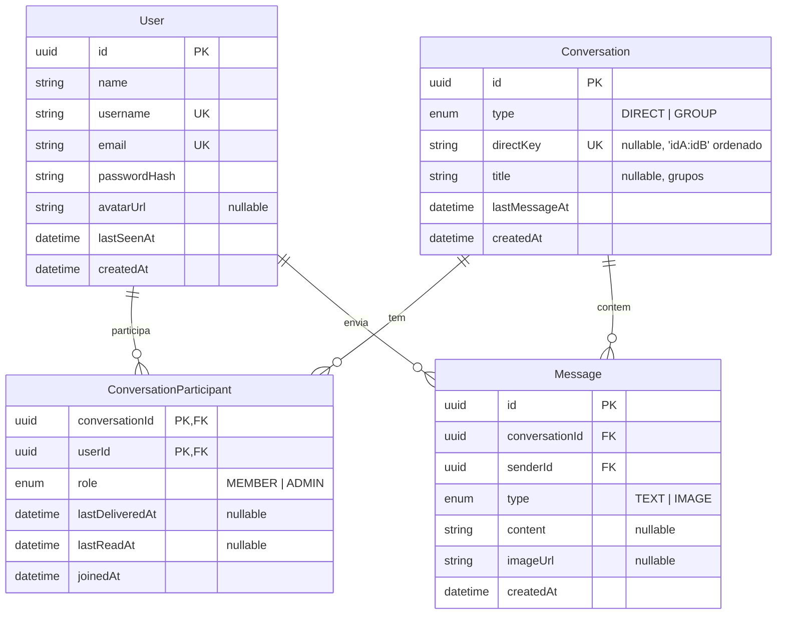

# Modelo de dados

## Decisões

| Decisão                                                                        | Por quê                                                                                                                                                                                                                         |
| ------------------------------------------------------------------------------ | ------------------------------------------------------------------------------------------------------------------------------------------------------------------------------------------------------------------------------- |
| **Status por marca d'água** (`lastDeliveredAt` / `lastReadAt` no participante) | Abrir uma conversa com 200 mensagens não lidas gera 1 `UPDATE`, não 200. O status é derivado: `createdAt <= lastReadAt` ⇒ lida; `<= lastDeliveredAt` ⇒ entregue; senão, enviada. Funciona igual para grupos.                    |
| **`Conversation.type` desde o MVP**                                            | Grupos entram sem migration destrutiva.                                                                                                                                                                                         |
| **`directKey` único**                                                          | O banco garante que dois usuários tenham no máximo uma conversa direta, inclusive se ambos clicarem ao mesmo tempo (condição de corrida).                                                                                       |
| **`lastMessageAt` desnormalizado**                                             | A lista de conversas é ordenada por índice, sem subquery em `Message`. Atualizado na mesma transação que cria a mensagem.                                                                                                       |
| **Paginação por cursor `(createdAt, id)`**                                     | Offset "pula" ou repete itens quando chegam mensagens novas em tempo real; cursor não, e continua eficiente em conversas longas. `id` desempata mensagens no mesmo milissegundo.                                                |
| **UUID como PK**                                                               | Não expõe volume de usuários/mensagens nas URLs nem permite enumeração.                                                                                                                                                         |
| **SQLite**                                                                     | Zero infraestrutura para rodar e testar. O schema não usa nada específico do SQLite: migrar para PostgreSQL é trocar o `provider` e regerar as migrations. Limites de tamanho dos campos são validados com Zod na borda da API. |
